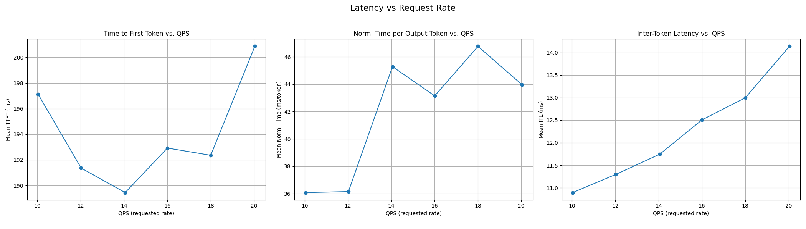
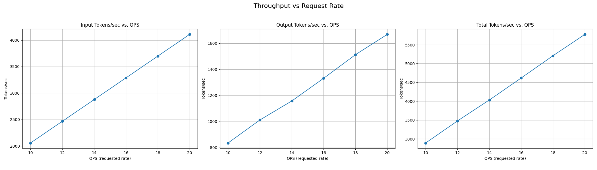
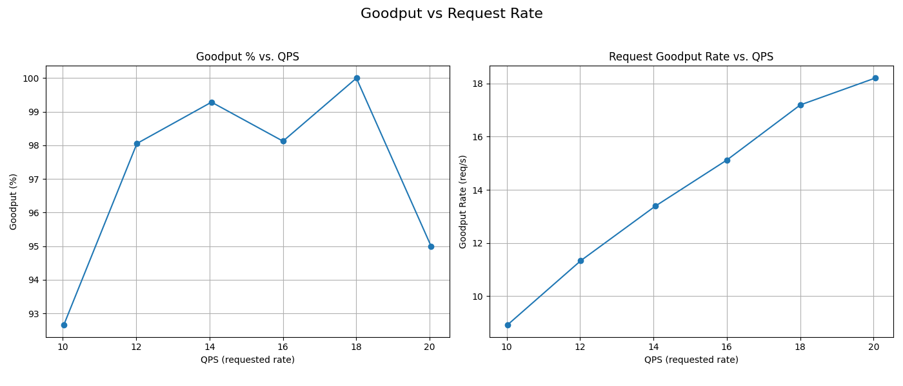
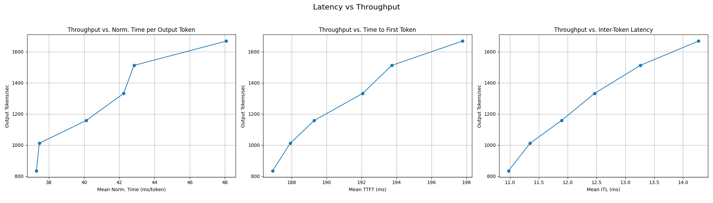

# Analyzing Benchmark Results

`inference-perf` provides a powerful analysis tool to visualize benchmark results across multiple stages or runs. This helps you understand system behavior under load and find optimal operating points.

## Generating Charts

To generate analysis charts, use the `--analyze` flag followed by the path to the directory containing your JSON reports:

```bash
inference-perf --analyze <path-to-reports-dir>
```

This command will read all `stage_*_lifecycle_metrics.json` files in the directory and generate a set of PNG charts.

## Comparing Runs

To plot several runs on the same charts, give more than one report directory and an existing output directory with `-u`:

```bash
inference-perf --analyze runs/vllm runs/sglang -u comparison/
```

The unified charts go into `comparison/`, together with `analyzed_reports_legend.json`, which maps each legend name to its report directory.

## Chart Options

| Flag | Default | What it does |
| --- | --- | --- |
| `--analyze-labels` | `Report 1`, `Report 2`, ... | Names for the report directories in the unified chart legends. Give one name for each directory, in the same order as `--analyze`. |
| `--analyze-rate` | `achieved` | The rate on the QPS axis. `achieved` is the rate at which requests were sent (`load_summary.achieved_rate`). `requested` is the rate configured for the stage (`load_summary.requested_rate`). The axis label names the rate it shows. |
| `--analyze-latency-stat` | `mean` | The latency statistic to plot: `mean`, `median`, `min`, `max` or a percentile such as `p90`. `p50` is the median. A report has only the percentiles in `report.request_lifecycle.percentiles` of its run. If a stage does not have the statistic, its latency points are skipped with a warning. If a report directory has no stage with the statistic, the unified latency and throughput-vs-latency charts are not drawn for any directory. |

For example, to plot p90 latency against the configured rate, with a name for each run in the legend:

```bash
inference-perf --analyze runs/vllm runs/sglang -u comparison/ \
  --analyze-labels vLLM SGLang --analyze-rate requested --analyze-latency-stat p90
```

The same options are available from Python:

```python
from inference_perf.analysis import analyze_reports

analyze_reports(
    ["runs/vllm", "runs/sglang"],
    "comparison/",
    labels=["vLLM", "SGLang"],
    rate="requested",
    latency_stat="p90",
)
```

## Available Charts

Here are the charts generated by running analysis on a recent benchmark run:

### 1. Latency vs Request Rate (QPS)
This chart shows how different latency metrics (TTFT, ITL, Norm. TPOT) scale as the request rate increases.



### 2. Throughput vs Request Rate (QPS)
This chart shows how input, output, and total token throughput scale with the request rate.



### 3. Goodput vs Request Rate (QPS)
This chart shows the percentage of requests that met the goodput constraints (Goodput %) and the rate of good requests as QPS increases.



### 4. Latency vs Throughput Curve
This chart plots throughput against latency, which is useful for finding the "knee" where latency starts to degrade rapidly as throughput increases.


