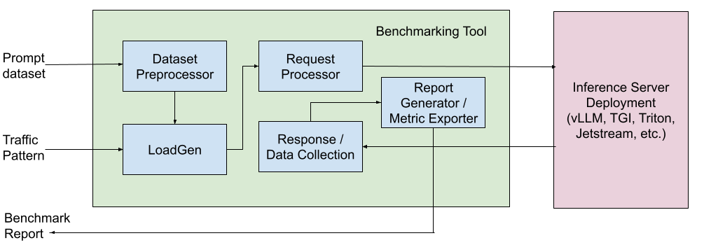

# Design

This document describes the high level design for the tool. It includes the
following components.

## Dataset Preprocessor

Dataset Preprocessor takes in a known dataset like ShareGPT or OpenOrca as the
input and pre-processes them by making sure the prompt length and generation
length are aligned with the user input to support different options like fixed
input / output length tests, variable length tests (larger input / smaller
output and the vice versa). This allows us to support different GenAI use cases
like chat completion, summarization, code completion, etc. depending on the
dataset and the benchmarking user’s inputs.

### Trace replay pipeline

Recorded workloads (OpenTelemetry traces, Weka traces) go through one shared
pipeline. A trace format is a parser that turns its source into a list of
`RawCall`s: one LLM call each, with its messages, recorded output, token counts
and timestamps. From there everything is format-neutral and lives in
`inference_perf/datagen/replay/replay_graph_builder.py`: `build_graph` infers
which calls depend on which, splits each prompt into the segments a predecessor
already sent (the KV cache reuse opportunity), tags the events whose output
reaches the user, and produces the `ReplayGraph` the session load generator
replays. Adding a trace format means adding a parser that produces `RawCall`s,
not a new replay path.

### Workload record layer

A recorded workload is stated as data, in two halves. A record is what one
request carries: the messages it sends, the tools it offers, the reply length
to ask for and, when the recording kept it, the reply that came back. A record
carries no timing. The requests of one session travel together as a session,
and the session's delivery says when and in what order they went out: one
schedule per record id. So a trace decodes into records plus a delivery. A
replay honours the delivery and a run paced by a load timer drops it, and the
records are the same either way. A request that belongs to no session is a
session of one. The schema lives in `inference_perf/workload/` and is
versioned `v1alpha3`.

A message's content is a list of parts, one class per kind of content: text,
image, audio, video, a tool call and a tool result. Text and media are stated
one of two ways, as recorded or as a spec to build at run time, because many
traces keep sizes and not content. Which way a part points is not on the part.
What a request sends is in `messages` and what came back is in `reply`, and a
reply that a later request carries as history is the same part in both places.
Every class and field has a one line description, and a unit test fails when
one is missing.

A trace format answers one question, what the rows of one session mean, and
returns a session. It takes rows as plain mappings and never opens a
file, picks sessions, builds text or knows an API. Reading (a directory, a
list of files or a Hugging Face dataset), keeping sessions (a filter, a cap
that stops the read), ordering them, shaping recorded waits and building text
are written once and shared by every format, so two formats that record the
same thing send the same thing.

Each field is there because some format records something the others do not:

| Field | What it states | Formats that need it |
| --- | --- | --- |
| `TextPart.text` | Text as recorded | Recorded conversations, TraceLab's empty round |
| `TextSpec.num_tokens` | Text to build to a length, because only the length was recorded | Azure, Mooncake, TraceLab, Weka |
| `TextSpec.block_ids`, `block_size` | The leading prefix blocks. Equal ids are equal text, which is what makes a cache hit reproducible without the text | Mooncake and Weka record them, TraceLab's are minted from its cached-prefix count |
| `TextSpec.scope` | Where a block id means the same text | `trace` for Mooncake (ids are global to the file), `session` for Weka and TraceLab |
| `ImagePart`, `AudioPart`, `VideoPart` | Media as recorded (`ref`) or to build (`spec`) | Multimodal traces. No format emits them yet |
| `ToolCallPart`, `ToolResultPart` | The model asking for a tool, and what the tool returned | Weka, for rounds that record `stop: tool_use` or `input_types: [tool_result]` |
| `ReasoningPart` | The model's thinking, apart from its answer, holding content the way a tool result does | Traces that record reasoning. No format emits it yet |
| `Record.tools` | The tools the request offers | Agent traces. No format emits them yet |
| `Record.output_tokens` | The output length to ask the server for | All |
| `Record.reply` | The recorded reply, so a later request that carries it can be recognized | Weka, recorded conversations |
| `Record.model`, `agent` | The model the request went to, and which agent of the session sent it | TraceLab and Weka record the model, Weka the agent |
| `Record.settings` | Request settings as recorded (sampling, tool choice), under the recording API's own names. The record does not interpret them: an API takes the ones it understands | Traces that record request bodies. No format emits them and no API reads them yet |
| `Record.call_id` | The tool call a subagent's request was sent to carry out. The same id is on the `ToolCallPart` that started the subagent and on the `ToolResultPart` that brings its work back, so the link survives a run that drops the delivery | Weka, when the round that spawned the subagent records `stop: tool_use` |
| `Delivery.schedules` | A schedule per record id, kept beside the records and not on them | All |
| `Schedule.start_ms` | The recorded send time | All; it is the whole schedule for Azure and Mooncake |
| `Schedule.duration_ms` | How long the request took in the recording | TraceLab, Weka |
| `Schedule.after`, `wait_ms` | The requests this one waited for, and how long after the last of them it went out | TraceLab (a chain per session), Weka (a graph with subagents) |

Three rules keep the schema this small:

- A record is one request and says nothing about when it is sent. Changing
  how a trace is delivered (capping waits, shifting start times, pacing it)
  replaces the delivery and leaves the records untouched.
- A request whose schedule names nothing in `after` is a timestamped request;
  one that waits for others is a call of a session. Which scheduler runs a
  trace follows from whether its format records sessions.
- A round that recorded its whole prompt is its own record. TraceLab and Weka
  record each round's full prompt rather than the messages added to it, and a
  prompt can come back shorter than the one before (context compaction, a
  rewind), so a round cannot be a message appended to the previous one.

A runtime that sends live replies as history does not compare text to find
them. `continues(session, record)` names the earlier record whose messages and reply
open a record's messages, so only the messages after those are new. It takes
the session because it needs both halves: the record's messages and the
records the delivery says it waited for.

This layer covers formats that record lengths, block ids or plain text. Their
records are numbers, so a trace's kept sessions are held whole and only the
text is built on demand, one session at a time. OTel traces stay on `RawCall`
and `ComplexReplayMessage` for now. Moving them onto this layer needs sessions
that are listed first and loaded one at a time, because an OTel corpus carries
full prompt text. The schema already states tool calls, tool results and tool
definitions. The workload generators send a tool call's arguments and a tool
result's content as plain message text for now, and reject media parts.
Shaping them as tool messages belongs to the API that builds the payload.

## Load Generator

Load Generator is the component which generates different traffic patterns based
on user input. This can include a fixed RPS test for a predetermined amount of
time or include a way to generate bursts in traffic or other traffic patterns as
desired for autoscaling and other use cases.

## Request Processor

Request Processor provides a way to support different model servers and their
corresponding request payload with different configurable parameters. This makes
our tool model server agnostic and provides a generic way to benchmark different
model servers and produce apples to apples comparison between them. This
component will also support different protocols like http and grpc and options
like request streaming which is important to produce time to first token (TTFT)
metric.

## Response Processor / Data Collector

Response Processor / Data Collector component allows us to process the response
and measure the actual performance of the model server in terms of request
latency, TPOT, TTFT and throughput.

## Report Generator / Metrics Exporter

Report Generator / Metrics Exporter generates a report based on the data
collected during benchmarking. It can also export the different metrics that we
collected during benchmarking as metrics into Prometheus which can then be
consumed by other monitoring or visualization solutions.

## Metrics to Collect

The following are the essential metrics that we want to collect using the
benchmarking tool.

*   Throughput
    *   Output tokens / second
    *   Input tokens / second
    *   Requests / second
*   Latency at different percentiles (mean, median, p90, p99)
    *   Time per output token (TPOT)
    *   Inter-token latency (ITL)
    *   Time to first token (TTFT)
    *   Time per request
*   Request metrics (mean, median, p90, p99)
    *   Prompt tokens
    *   Output tokens

Optionally we also want to collect specific accelerator and model server metrics.

*   Accelerator metrics (mean, median, p90, p99)
    *   Accelerator utilization (duty cycle)
    *   Accelerator memory utilization
    *   Accelerator memory bandwidth utilization
    *   Accelerator power usage
*   Model server metrics (mean, median, p90, p99)
    *   Batch size
    *   Queue size
    *   KV cache usage
