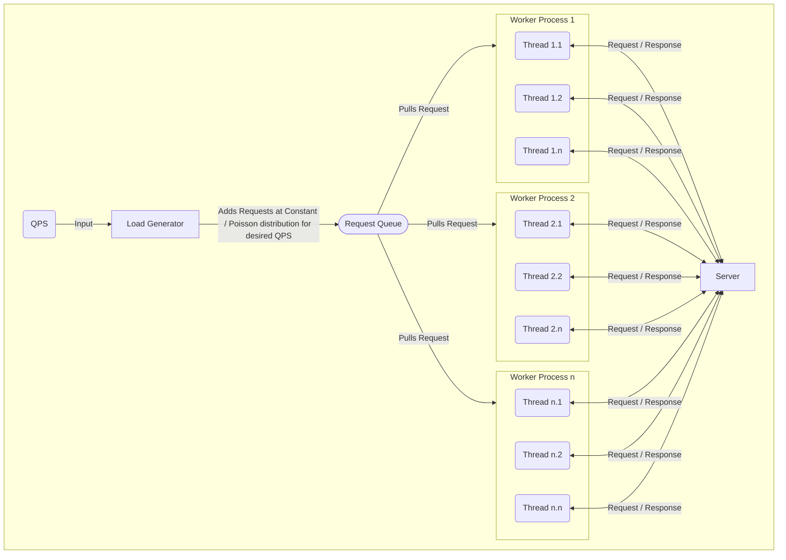

# Load Generation Guide

Inference Perf generates load at the specified request rate based on a multi-process architecture where it uses the CPUs available to the process to spin off as many processes as denoted by [`num_workers`](CONFIG.md#load-configuration) and within each process, it spins off as many threads as denoted by [`worker_max_concurrency`](CONFIG.md#load-configuration) to achieve the specified request rate. By default `num_workers` is `min(CPU affinity, cgroup CPU quota when present, host CPUs)`, so container CPU limits and cpuset/taskset pinning are honored. This multi-process architecture allows inference-perf to scale to 10k+ QPS which is not possible otherwise. Windows uses a `spawn` context because forkserver is unavailable; POSIX uses `forkserver`.

## Architecture

The load generator uses a multi-process architecture to scale to high request rates. The main process coordinates worker processes, each of which runs multiple threads to execute requests. The number of workers and threads per worker are configurable.

## Load Types

Inference Perf supports several load types:

- **Constant**: Requests are dispatched at a constant rate.
- **Poisson**: Requests follow a Poisson process with a given rate.
- **Trace Replay**: Requests are replayed from a trace file.

## Configuration

The load generation is configured through the `LoadConfig` object, which specifies:

- `type`: The load type (constant, poisson, trace_replay).
- `stages`: A list of load stages, each with a rate and duration.
- `num_workers`: The number of worker processes.
- `worker_max_concurrency`: The maximum number of concurrent requests per worker.

## Metrics Collection

Metrics are collected from each worker and aggregated by the main process. The metrics include:

- Latency (TTFT, ITL, E2E)
- Throughput
- Error rates
- Queue depths

## Reports

Reports are generated in multiple formats:

- JSON: Machine-readable detailed metrics
- Markdown: Human-readable summary
- Prometheus: For integration with monitoring systems

## Troubleshooting

If you notice issues with the delay or achieved rate, that means the benchmarking machine or the concurrency parameters need to be tweaked further.